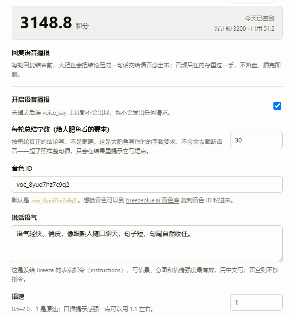
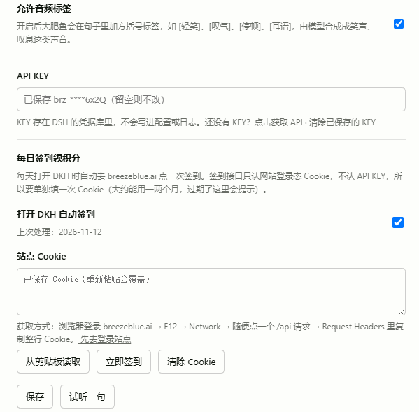

# dsh-tts-voice

每轮回复结束前，让模型把结论压成一句话，交给 Breeze TTS 念出来（语音播报）。
只播放，不落盘：音频在内存里过一手，播完即 revoke，不留任何文件。

[English](#english) · [截图](#截图) · [设置](#设置)

## 功能

- **每轮收尾语音**：注册工具 `voice_say`，模型在最终回复前调用一次，把结论念出来。顺手当「这轮干完了」的语音提示。
- **不落盘**：host 侧合成后的字节只经同源路由进浏览器内存 → `Audio` 播放 → `URL.revokeObjectURL`，磁盘上不出现音频文件。
- **音频标签**：文本里可以写中文方括号标签（`[轻笑] [叹气] [停顿] [耳语] [咂嘴] [哼歌] [冷笑] [闷哼] [咳嗽] [打哈欠]`），由模型直接合成笑声、叹气这类声音；英文场景用圆括号 `(sighs)`。
- **表演指令**：可选 `instructions` 参数写一句中文表演指令（情景 / 意图 / 情绪强度），配合语速、音量、guidance 一起用。
- **字数只是写作要求**：设置页的「每轮总结字数」是给模型看的写作约束，**不会截断语音** —— 超了照样整句播，工具结果里会提醒超了几字。
- **不做强制 steer**：没有「漏调就 steer 提醒」的兜底。`agent.steer()` 传裸字符串时，DSH 会原样塞进 `agent/inbox/spliced.inserted`，而该校验要求 message 对象 —— 写出的会话日志自己读不回来（`SessionFormatError`），整个会话直接打不开。所以只靠系统提示里的常驻规则约束模型，不在运行时强推。
- **KEY 不进配置**：API KEY 存 DSH 凭据库（`BREEZE_TTS_API_KEY`），不写配置文件、不进日志、不进浏览器。
- **顺手签到**：内置 Breeze 站点每日签到（详见下方「每日签到」）。

## 安装

```bash
git clone https://github.com/pandaman0759/dsh-tts-voice
```

然后在 DSH 里安装这个本地 bundle（二选一）：

- 设置 → 插件 → 从本地目录安装，选这个仓库目录；
- 或让 agent 执行 `plugin_manager` 的 `install_bundle`，`target` 填仓库绝对路径。

装好后：**设置 → 语音播报**，填 Breeze API Key（[点这里获取](https://breezeblue.ai/zh?code=7JXP7Y)），保持「开启语音播报」勾选。

## 截图

设置页（积分卡片 + 语音播报设置）：



签到与 Cookie：



## 设置

| 项 | 说明 |
| --- | --- |
| 开启语音播报 | 总开关。关闭后 `voice_say` 不注册，不产生任何请求 |
| 每轮总结字数 | 默认 20。模型的写作要求，不截断语音 |
| 音色 ID | 默认 `voc_8yud7hz7c9q2`，可在 [音色库](https://breezeblue.ai/zh?code=7JXP7Y) 复制 |
| 说话语气 | `instructions`：写情景、意图、情绪强度最有效，中文写，留空则不加指令 |
| 语速 / 音量 | 0.5–2.0 / 0.01–2.0；1 是原速、原音量 |
| 允许音频标签 | 关掉后模型只会写纯文本 |
| API KEY | 存凭据库，不落配置 |

## 每日签到

Breeze 站点每天可以领积分，这个插件可以顺手自动领：

- 页面接口只认**网站登录 Cookie**，不认 API KEY（`/api/credits/summary` 带 Bearer 仍是 401），所以需要手动粘一次 Cookie；
- 获取方式：浏览器登录 breezeblue.ai → F12 → Network → 随便点一个 `/api` 请求 → 复制整行 Cookie；
- 设置页有「从剪贴板读取」按钮，粘一次能用一两个月，失效会在设置页红字提示；
- 每次打开 DKH 自动签一次（同一天不重复），签到额度与小票（今日已领 / 可领多少）显示在设置页顶部大字卡片里。

## 架构

- Host（`index.js`）：
  - 注册工具 `voice_say`（仅开关打开时）；
  - 内存队列 + `GET /api/dsh-tts-voice/next|audio|ack`：页面取文本、取音频字节、播完回执；
  - `GET|POST /api/dsh-tts-voice/config` 设置读写；`POST /preview` 试听；
  - `GET|POST /api/dsh-tts-voice/credits` 签到与积分余额；
  - KEY 走 `credentials` 服务；配置走 `configEditor`。
- Client（`client.js`）：900ms 轮询队列 → 取音频 → `Audio` 播放 → revoke；设置页走 `settings.section` slot。
- 合成请求：`POST https://api.breeze.blue/v1/text-to-speech/{voice_id}?output_format=mp3`，`xi-api-key` 头，body `{text, model_id, language_code, instructions?, voice_settings?}`。

## 隐私

- 只有你写的那句总结会发给 Breeze 合成，其他任何内容都不会外传。
- 音频不落盘、不缓存到磁盘；队列只存文本，播完即删。
- API KEY 与站点 Cookie 存在 DSH 凭据库。

## License

MIT

---

## English

A DeepSeek Harness plugin that speaks a one-sentence summary of each finished turn.

- Registers a `voice_say` tool the model calls before its final message.
- Host-side synthesis via Breeze TTS; audio is streamed to the page, played from a blob URL, then revoked — never written to disk.
- Supports Chinese audio tags (`[轻笑] [叹气] [停顿] …`) and free-form Chinese `instructions` for delivery.
- The configured character budget is a writing hint for the model, never a truncation point.
- API key is stored in the harness credential store, not in config files.
- Also includes the site's daily credit check-in (cookie-based, one paste, then automatic once per day).

Install: clone the repo, then install this directory as a local bundle and open **Settings → 语音播报**.
